<div align="center">




<br/>


<br/>


<br/><br/>

**[🛰️ About](#-about-me) · [🧬 Arsenal](#-technology-arsenal) · [🚀 Projects](#-featured-projects) · [📊 Stats](#-github-statistics) · [🔭 Exploring](#-currently-exploring) · [🧭 Journey](#-journey-and-goals) · [🌐 Connect](#-connect-with-me)**

</div>


## 🛰 About Me

I'm **IH SAFY**, a Computer Science & Engineering graduate from **East West University, Dhaka**, working at the intersection of **Artificial Intelligence, Machine Learning, Deep Learning, Computer Vision, and Medical Imaging**. I like taking a problem the whole way — from raw, messy data to a model running behind a real interface.

```ts
// ihsafy.config.ts
export const ihSafy = {
  role:      "AI & ML Engineer",
  education: "B.Sc. CSE · East West University",
  location:  "Dhaka, Bangladesh",
  focus:     ["Data Analytics", "Machine Learning", "Deep Learning",
              "Computer Vision", "Medical Imaging", "LLM & RAG"],
  ships:     "end-to-end: data → model → API → UI → VPS",
  mission:   "Turn raw data into intelligent systems that help real people.",
} as const;
```

> [!IMPORTANT]
> I build intelligent systems **end to end**: cleaning and annotating data, training and fine-tuning models, then deploying them on my own servers with a domain and SSL.

<table>
<tr>
<td valign="top" width="50%">

**🎓 Education**
B.Sc. in Computer Science & Engineering — East West University

**🧠 Core interests**
Artificial Intelligence · Machine Learning · Deep Learning · Computer Vision · Medical Imaging · Data Analytics

</td>
<td valign="top" width="50%">

**🛠️ What I build**
Model training & fine-tuning · CV pipelines · RAG systems · REST APIs · full-stack web

**🚀 How I ship**
Data → model → API → UI → Linux VPS with domain + SSL

</td>
</tr>
</table>


## 🧬 Technology Arsenal

<div align="center">

|  |
|:--|
|  |

|  |
|:--|
|  |

|  |
|:--|
|  |

|  |
|:--|
|       |

|  |
|:--|
|  |

|  |
|:--|
|  |

|  |
|:--|
|  |

</div>

<details open>
<summary><b>🔎 Capability matrix</b></summary>
<br/>

| Domain | What I do | Level |
|:--|:--|:--|
| 🧠 **Deep Learning** | Model training · fine-tuning · CNNs · transfer learning |  |
| 👁️ **Computer Vision** | Detection · classification · preprocessing · augmentation |  |
| 🩻 **Medical Imaging** | Detection · enhancement · leveling · analysis |  |
| 💬 **LLM & RAG** | Retrieval pipelines · prompt design · automation |  |
| 🧹 **Data Engineering** | Cleaning · annotation · dataset preparation |  |
| 🕸️ **Full-Stack Web** | React · Node.js · PHP · REST APIs |  |
| 🚀 **Deployment** | VPS · Linux · Domain & SSL · server hosting |  |

</details>


## 🚀 Featured Projects

<table>
<tr>
<td width="50%" valign="top">

### 🧠 [MindScanner AI](https://github.com/ihsafy/automated-multi-class-classification-of-MRI)

Multi-class Alzheimer's disease stage classification from MRI images using **Inception-ResNet-V2**, with quantitative and qualitative evaluation.

  

<a href="https://github.com/ihsafy/automated-multi-class-classification-of-MRI"><b>View repository →</b></a>

</td>
<td width="50%" valign="top">

### 🦷 [Dental AI Pro](https://github.com/ihsafy/dental-ai-pro)

Machine learning system for detecting **dental irregularities from panoramic radiograph images** to support automated dental diagnosis and analysis.

  

<a href="https://github.com/ihsafy/dental-ai-pro"><b>View repository →</b></a>

</td>
</tr>
<tr>
<td width="50%" valign="top">

### 💎 [Rora Luxe](https://github.com/ihsafy/bespoke-e-commerce)

Curated luxury marketplace for premium lifestyle goods (watches, bags, apparel) with a premium **"Luxury Dark"** UI and a secure backend.

  

<a href="https://github.com/ihsafy/bespoke-e-commerce"><b>View repository →</b></a>

</td>
<td width="50%" valign="top">

### 📚 [Book Seekers](https://github.com/ihsafy/book_seekers)

PHP-based peer-to-peer marketplace that lets book lovers **buy, sell, and donate books**, with dynamic database management and search.

  

<a href="https://github.com/ihsafy/book_seekers"><b>View repository →</b></a>

</td>
</tr>
</table>

**🧩 More on GitHub**

- 🍔 **[EWU Food Hub](https://github.com/ihsafy/EWU-Food-Hub)** — student-focused campus food ordering platform with a fast, responsive UI.
- 🩻 **[Dental OPG Detection (YOLOv8-M)](https://github.com/ihsafy/Dental-Full-Mouth-X-ray-OPG-Teeth-Problem-Detection-using-YOLOv8-M)** — object detection of common tooth conditions on full-mouth panoramic X-rays.
- 🍽️ **[Online Food Delivery System](https://github.com/ihsafy/online-food-delivery)** — PHP & MySQL ordering with cart, dummy payments, rider chat, delivery tracking, and an admin dashboard.
- 🔬 **[EfficientNet Endoscopy](https://github.com/ihsafy/EfficientNet-Endoscopy)** — EfficientNet-based endoscopy image analysis.

<div align="center">

<a href="https://github.com/ihsafy?tab=repositories"></a>

</div>


## 📊 GitHub Statistics

<div align="center">


<br/>


<br/>


</div>

<!--
  Contribution SNAKE animation (optional, requires one-time setup):
  It is NOT shown here because it requires a GitHub Actions workflow in the "ihsafy" profile repo,
  and the output branch does not exist yet. A broken image would appear until it is set up.
  To enable it, add the Platane/snk action to ihsafy/ihsafy, then embed:
  
-->


## 🔭 Currently Exploring

<table>
<tr>
<td width="33%" valign="top" align="center">

### 👁️ Computer Vision

Detection · classification<br/>robust preprocessing

</td>
<td width="33%" valign="top" align="center">

### 🩻 Medical Imaging

Disease detection · scan<br/>enhancement · analysis

</td>
<td width="33%" valign="top" align="center">

### 💬 LLM & RAG

Retrieval pipelines · prompt<br/>design · automation

</td>
</tr>
<tr>
<td valign="top" align="center">

### 🤖 AI Agents

Tool use · workflows<br/>orchestration

</td>
<td valign="top" align="center">

### 📈 Data Analytics

Cleaning · imputation · clustering<br/>dimensionality reduction

</td>
<td valign="top" align="center">

### 🚀 Inference Infra

Scalable serving · Linux<br/>deployment · MLOps

</td>
</tr>
</table>


## 🧭 Journey and Goals

<table>
<tr>
<td valign="top" width="55%">

| Stage | Focus | Highlights |
|:--|:--|:--|
| **01 · Foundation** | Core programming · databases · web | C, C++, Java, Python, PHP, JavaScript, SQL |
| **02 · Machine Learning** | Training · data prep · augmentation | scikit-learn, TensorFlow, PyTorch |
| **03 · Specialization** | Computer vision · medical imaging | MindScanner AI, OpenCV pipelines |
| **04 · Now** | LLM engineering · RAG · agents | Retrieval systems, automation |
| **05 · Next** | Scalable AI infra · open source | Contributing to impactful AI projects |

</td>
<td valign="top" width="45%">

**🎯 Goals**

- [x] Build and deploy full-stack apps on my own VPS
- [x] Train and ship a medical-imaging classifier
- [x] Learn LLM + RAG fundamentals
- [ ] Build production-grade AI agents
- [ ] Publish medical imaging research
- [ ] Contribute to open-source AI
- [ ] Become a world-class AI engineer

</td>
</tr>
</table>


## ❓ FAQ

<details>
<summary><b>What can I ask you about?</b></summary>
<br/>
Computer vision, medical image processing, machine learning and deep learning, data analytics, RAG pipelines, dataset preparation, and deploying apps on Linux with SSL.
</details>

<details>
<summary><b>Are you open to collaboration?</b></summary>
<br/>
Yes. I'm especially interested in medical imaging research, AI/ML engineering, data analytics, and open-source AI.
</details>

<details>
<summary><b>What's your typical workflow?</b></summary>
<br/>
Collect and clean data → annotate → preprocess and augment → train and fine-tune → evaluate → REST API → React UI → deploy on VPS with domain and SSL.
</details>

<details>
<summary><b>Best way to reach me?</b></summary>
<br/>
Email is fastest: <a href="mailto:ihsafy2k21@gmail.com">ihsafy2k21@gmail.com</a>
</details>


## 🌐 Connect With Me

<div align="center">

<a href="https://ihsafy.vercel.app"></a>
<a href="mailto:ihsafy2k21@gmail.com"></a>
<a href="https://github.com/ihsafy"></a>

</div>


<div align="center">

<sub><i>"Artificial Intelligence is not replacing human potential, it is amplifying what humanity can become."</i></sub>

<br/><br/>


</div>
