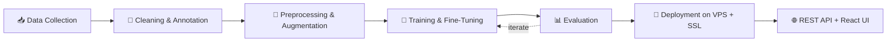
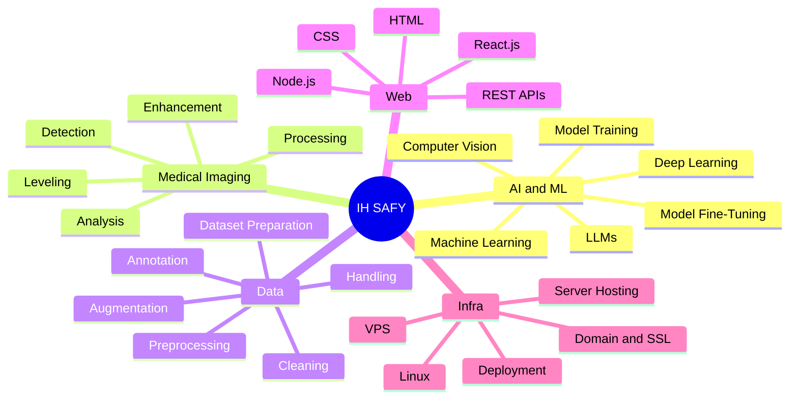

<!-- ===================== IH SAFY • NEURAL EDITION ===================== -->


<p align="center">
  
</p>

<p align="center">
  
  
  
  
  
</p>


## 🛰️ `whoami`

```bash
$ cat ih_safy.profile

  name       →  IH SAFY
  location   →  Dhaka, Bangladesh 🇧🇩
  education  →  B.Sc. CSE @ East West University
  mission    →  Build impactful AI systems for real-world problems
  focus      →  [ ML • DL • Computer Vision • Medical Imaging • LLM • RAG ]
  status     →  ● online · learning · shipping
```

> [!NOTE]
> I build intelligent systems end to end: from cleaning and annotating data, to training and fine-tuning models, to deploying them on my own servers.

## 🧬 My AI Pipeline



## 🗺️ Skill Map



## ⚙️ Tech Arsenal

<table>
<tr>
<td width="50%" valign="top">

**👨‍💻 Programming Languages**


`C` · `C++` · `Java` · `Python` · `PHP` · `JavaScript`

</td>
<td width="50%" valign="top">

**🌐 Web Technologies**


`HTML` · `CSS` · `React.js` · `Node.js` · `REST APIs`

</td>
</tr>
<tr>
<td valign="top">

**🗄️ Database Systems**


`MySQL` · `MongoDB` · `PostgreSQL` · `SQL`

</td>
<td valign="top">

**🤖 AI & Machine Learning**


`Machine Learning` · `Deep Learning` · `Model Training` · `Model Fine-Tuning` · `Computer Vision` · `LLMs`

</td>
</tr>
<tr>
<td valign="top">

**🩻 Medical Image Processing**

`Medical Image Detection` · `Image Processing` · `Image Enhancement` · `Image Leveling` · `Medical Image Analysis`

</td>
<td valign="top">

**🧹 Data Handling & Preparation**

`Data Cleaning` · `Data Annotation` · `Data Preprocessing` · `Data Handling` · `Dataset Preparation` · `Data Augmentation`

</td>
</tr>
<tr>
<td valign="top">

**🖥️ Server & Deployment**


`VPS` · `Server Hosting` · `Linux` · `Domain & SSL Configuration` · `Deployment`

</td>
<td valign="top">

**⚙️ Tools & Platforms**


</td>
</tr>
</table>

<details>
<summary><b>📎 Productivity Tools (click to expand)</b></summary>
<br>


</details>

## 🚀 Featured Projects

| 🧠 **MindScanner AI** | 💎 **Rora Luxe** |
|:---|:---|
| **Alzheimer's MRI Classification System** | **Luxury E-Commerce Platform** |
| CNN-powered MRI analysis<br>Multi-class classification<br>AI-assisted disease prediction | Full-stack marketplace<br>Responsive premium UI<br>Secure backend architecture |
|    |    |

| 📚 **Book Seekers** | 🍔 **EWU Food Hub** |
|:---|:---|
| **Smart Digital Library** | **Smart Campus Food Platform** |
| Intelligent search system<br>Dynamic database management<br>Optimized user experience | Student-focused food solution<br>Real-time responsive UI<br>Fast interactive experience |
|    |    |

## 🔭 Currently Exploring

```diff
+ LLM Engineering & AI Agents
+ RAG Pipelines
+ Advanced Computer Vision
+ Medical Imaging Research
+ Scalable AI Infrastructure & Deployment
+ AI Automation
```

## 🎯 Vision

> [!TIP]
> Researching Computer Vision and Medical Imaging, building automation with LLMs and RAG, contributing to impactful open-source AI, and working toward becoming a world-class AI Engineer.

## 📡 Contact

<p align="center">
  <a href="mailto:ihsafy2k21@gmail.com"></a>
  <a href="https://github.com/ihsafy"></a>
</p>

<p align="center"><i>"Artificial Intelligence is not replacing human potential, it is amplifying what humanity can become."</i></p>


